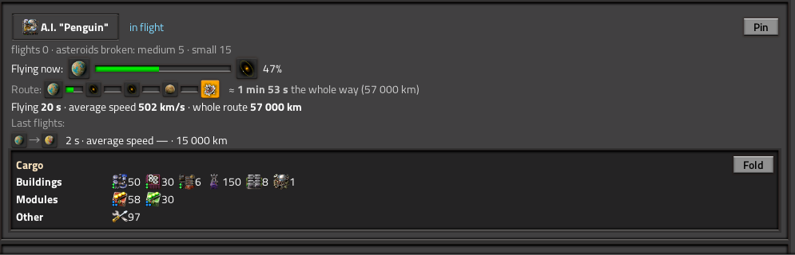
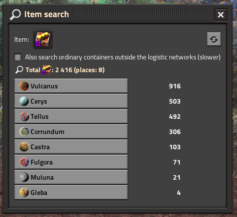
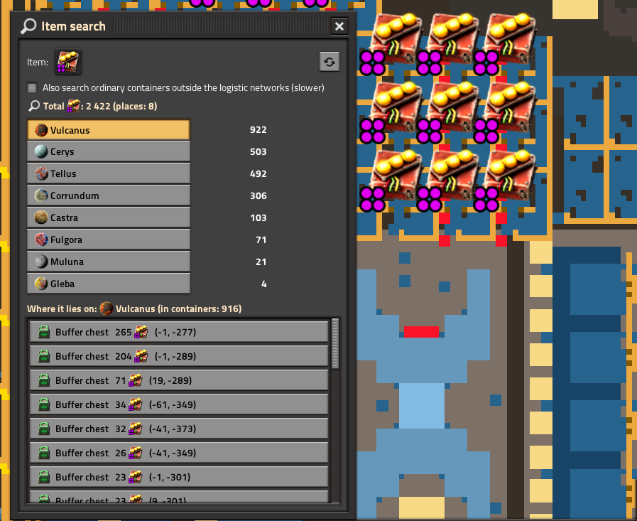
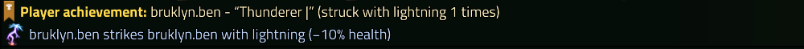

The mod is free. If you like it, you can say thanks with a one-time donation on Boosty: no subscription is needed.

**Support in English and Russian / Поддержка на русском и английском.** Questions, bugs and ideas: Discussion tab.

# Factory Radar

**Your whole factory in one window.** See where your space platforms are and what they carry, where the power fails and why, find any item across all your logistic networks in one click, and see who is where and what they are doing.

Press the radar button (or `Ctrl+Shift+R`) and it is all there. No setup, no new items, nothing changes in your world. It is just as useful in a solo game as it is with friends.

- **Know your factory**: space platforms, item search, power grids, planets, research.
- **Play with friends**: who is where, titles next to your name, achievements, shift summaries, a few fun toys.
- **Works with your setup**: modded planets and enemies, English and Russian, light on UPS.

---

# Know your factory

## Space platforms

- Where each platform is and where it flies: the route with distances, flight time, average speed, the progress of the current leg.
- A record of the last flights of every platform.
- Cargo sorted by category, so you see at once what a platform really carries.
- Asteroids broken on the way, platforms that stand still or wait for a starter pack.
- When a platform is destroyed it goes to its own list with the route it was on and the probable cause.

## Find any item

Lost a stack of something? Press **Find item**.

1. Pick an item. Choose its quality too.
2. You get every logistic network of every planet and platform that holds it, with totals.
3. Click a place: the camera flies there and the containers with the item are highlighted on the map. Each row shows the container with its quality, how many items are inside and who holds them.
4. Items in a player's inventory are listed with the player's name. A switch also looks into ordinary chests outside the networks.

## Power grids

Every planet with a network gets a status: enough, on the edge or out of power. Hover over it to see the probable reason.

- Demand jumped, and which machine grew the most.
- A source dropped, and which one.
- Accumulators are empty, or full but not connected to the network.
- No storage on the planet at all.
- A planet where nothing is generated says so instead of a calm "enough".
- A log keeps the last events, so you can see what happened while you were away.

## Planets, research, combat

- **Planets**: which ones you have mastered and what each one still needs. The "native" science of every planet is found by the mod (an admin can fix it for modded planets). Output per shift, the pace against the last shift, who built the most on each planet.
- **Research and quality**: progress, infinite levels, milestones (the 1st, 1 000th, 10 000th pack), science really made and spent per minute, and what you got above normal quality.
- **Combat**: what you kill and what kills you, per planet and per weapon. The evolution of every enemy faction with history by shifts. What the enemies destroyed.

---

# Play with friends

## Who is where

Every player: the planet, what they are doing, where they look. One click flies you to them or to the place they look at. A lightning button sits next to each name. The Players tab has a card for every player with stats, titles and achievements.

## Titles and achievements

- Dozens of titles: some funny, some serious, some very hard, some depend on the planet (lava, oceans, enemies, peace). Many are painted in their own colours.
- Pick a title and it shows next to your name in chat.
- Achievements are personal: you see yours in chat. Team milestones are shown to everyone.

## Shifts and MVP

- At the end of every shift a summary appears in chat: leaders, destruction, research, planets, power problems.
- Players vote for the MVP, the vote is secret. If nobody votes, the mod picks the MVP itself by the share in kills, buildings, mining and distance, and the journal says why.

## Fun stuff

- **Lightning**: strike a friend with a lightning bolt. It never kills, it only takes part of the health. Several players can strike the same target.
- **Quiz**: anybody can start it, those who agree take part, fate picks one of them and a surprise awaits that player. One quiz at a time, with a cooldown.

---

# Works with your setup

- **Other mods**: works with the base game, with Space Age and without, with Quality and without. Modded planets, space locations and enemies are picked up by themselves, with their own icons.
- **Languages**: English and Russian, follows the game language. Support in both.
- **Multiplayer**: safe, nothing in the world is changed except what you ask for (the lightning and the quiz).
- **Light on UPS**: only the open tab is built, the heavy counting is done in small steps.
- **Settings**: an admin can switch every feature on or off and reset or undo any statistic, one section at a time. Players hide the tabs and chat messages they do not need, each for themselves.

## Commands

Everything is also in the window, the commands are for quick use from chat.

| Command | What it does |
| --- | --- |
| `/tr-now` | Right now: shift leaders, planets, time to the summary |
| `/tr-top [shift]` | Team stats, all time or for the shift |
| `/tr-me [name]` | A player card |
| `/tr-vs name` | Compare yourself with a player |
| `/tr-where [name]` | Who is where and where they look |
| `/tr-planets`, `/tr-research`, `/tr-combat`, `/tr-log` | Short reports in chat |
| `/tr-mvp name` | Vote for the MVP of the shift |
| `/tr-zap name` | Strike a player with lightning |
| `/tr-roulette`, `/tr-in` | Start the quiz, agree to take part |
| `/tr-shift-now` (admin) | Sum up the shift right now |
| `/tr-census` (admin) | Recount who built what on the planets |
| `/tr-zap-lift number` (admin) | Fix the height of the lightning |

## Versions

`1.0.x` is for Factorio 2.0 (2.0.36 or newer), `1.1.x` is for Factorio 2.1 (2.1.7 or newer).

## Bugs and ideas

Write in the Discussion tab, in English or in Russian. If something breaks, please attach `factorio-current.log` (look for lines with "Factory Radar").
