

The mod is free. If you like it, you can say thanks with a one-time donation on Boosty: no subscription is needed.

**Support in English and Russian / Поддержка на русском и английском.** Questions, bugs and ideas: Discussion tab.

# Factory Radar

**Your whole factory in one window.** See where your space platforms are and what they carry, where the power fails and why, find any item on planets, platforms and with players in one click, and see who is where and what they are doing.

Press the radar button (or `Ctrl+Shift+R`) and it is all there. No setup, no new items, nothing changes in your world. It is just as useful in a solo game as it is with friends.

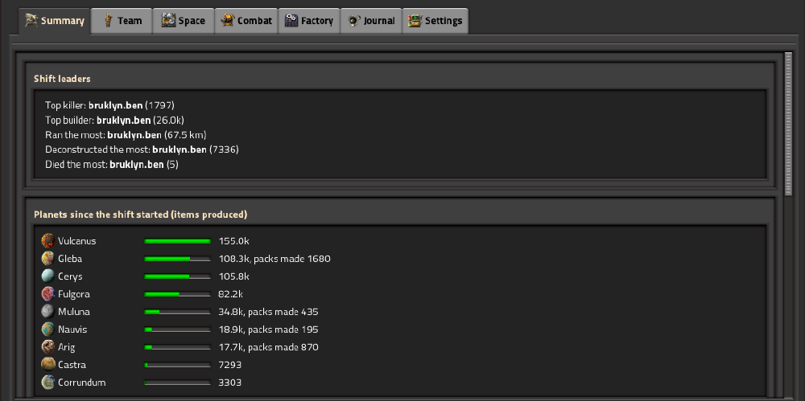

*The Summary tab: the leaders of the shift and what every planet produced.*

- **Know your factory**: space platforms, item search, power grids, planets, research.
- **Play with friends**: who is where, titles next to your name, achievements, shift summaries, a few fun toys.
- **Works with your setup**: modded planets and enemies, English and Russian, light on UPS.

---

# Know your factory

## Space platforms

- Where each platform is and where it flies: the route with distances, flight time, average speed, the progress of the current leg.
- A record of the last flights of every platform.
- Cargo sorted by category, so you see at once what a platform really carries.
- Asteroids broken on the way, platforms that stand still or wait for a starter pack.

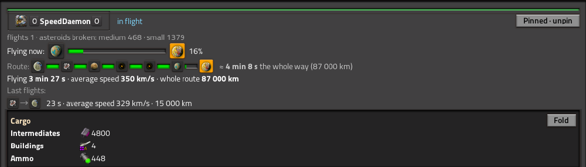

*A platform card: the route with the progress of the current leg, the last flight and the cargo by category.*

When a platform is destroyed it goes to its own list with the route it was on and the probable cause.

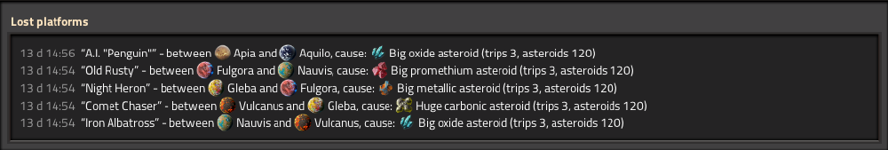

*Destroyed platforms: where they were, what hit them, how many flights and broken asteroids they had.*

## Find any item

Lost a stack of something? Press **Find item**.

1. Pick an item. Choose its quality too.
2. You get every planet and platform that holds it, the most first, with the total.
3. Four boxes pick where to look: logistic networks, what players carry, chests outside the networks and inside machines (the last two take longer, so they are off at first).
4. Click a place: the camera flies there and the containers with the item are highlighted on the map. Each row shows the container with its quality and how many items are inside. Hover a row to see the coordinates.
5. The window can be collapsed to a small bar and kept on the screen.

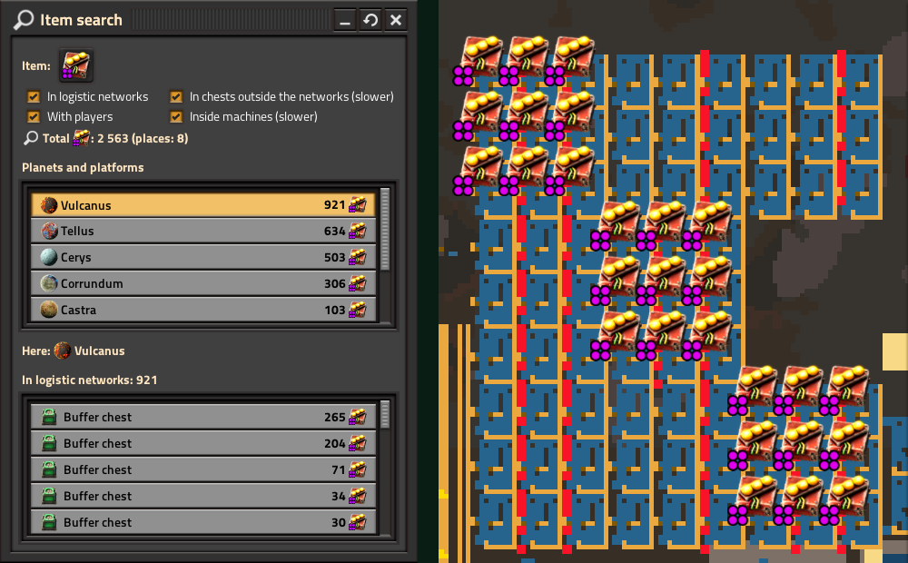

*Item search: the places on the left, the containers it highlights on the map on the right.*

## Power grids

Every planet with a network gets a status: enough, on the edge or out of power. Hover over it to see the probable reason and the trend of the consumption.

- Machines that really lack power are written to the journal in red, after a short while so a blink does not count.
- Warnings in yellow: no fuel or steam, fuel running out, accumulators that will not last until dawn (the length of the night is taken from the planet), a fast drain, demand that keeps growing.
- The capacity of the sources takes the quality of the buildings and the sun of the planet or of the place in space into account.

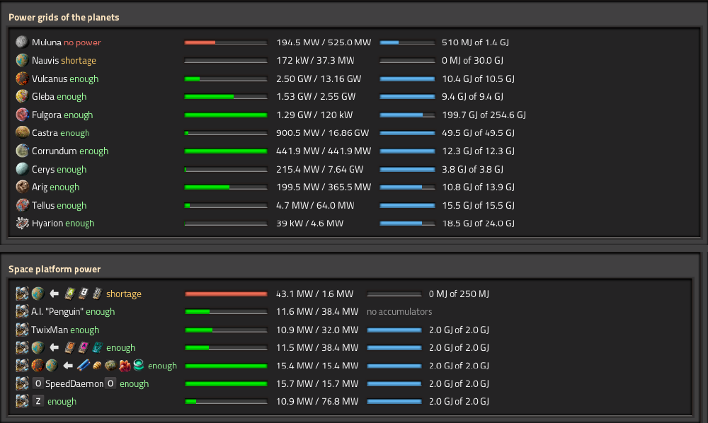

*Power grids: every planet and every platform with its load and the charge of its accumulators.*

Space platforms have their own block: the charge, the load and the same red and yellow states. One journal for planets and platforms keeps the exact game time, how long it lasted and the probable causes.

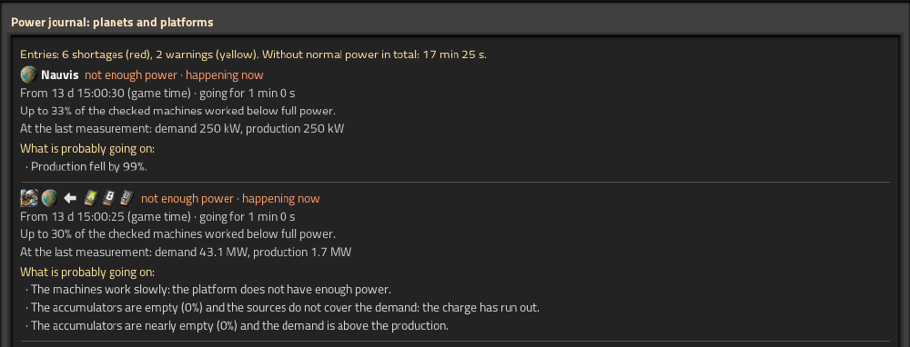

*The journal: when it started, how long it lasted, how many machines worked below full power and the probable cause.*

## Planets, research, combat

- **Planets**: which ones you have mastered and what each one still needs. The "native" science of every planet is found by the mod (an admin can fix it for modded planets). Output per shift, the pace against the last shift, who built the most on each planet.
- **Research and quality**: progress, infinite levels, milestones (the 1st, 1 000th, 10 000th, 100 000th, millionth and billionth pack), science really made and spent per minute, and what you got above normal quality.
- **Combat**: what you kill and what kills you, per planet and per weapon. The evolution of every enemy faction with history by shifts. What the enemies destroyed.

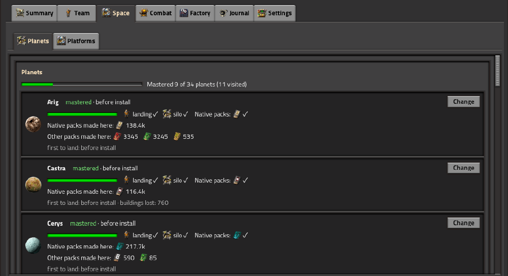

*The Planets tab: what is mastered, the native science of each planet and the packs made there.*

---

# Play with friends

## Who is where

Every player: the planet, what they are doing, where they look. One click flies you to them or to the place they look at. A lightning button sits next to each name. The Players tab has a card for every player with stats, titles and achievements.

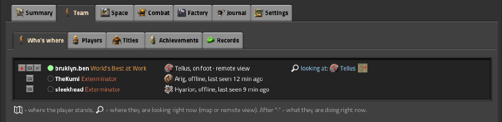

*Who is where: every player, their planet, what they are doing and where they look.*

Click a name and you get the card of the player.

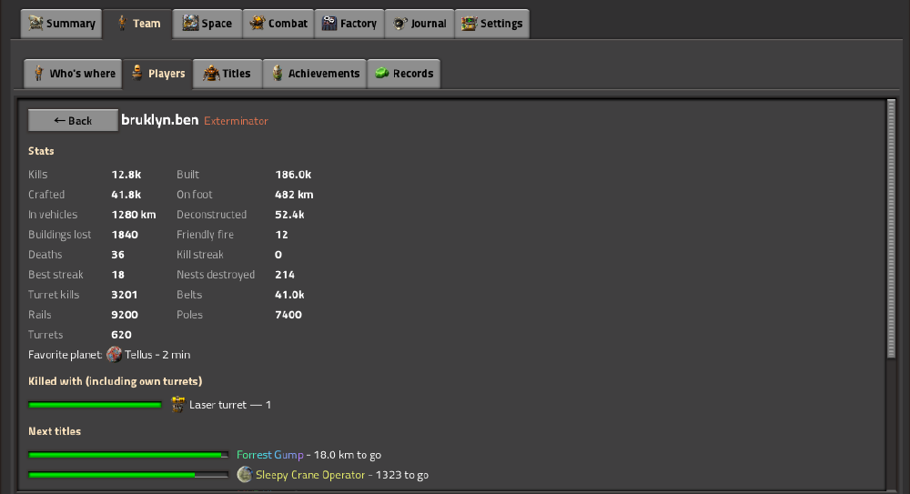

*A player card: the stats, the favourite planet, what they killed with and the next titles.*

## Titles and achievements

- Dozens of titles: some funny, some serious, some very hard, some depend on the planet (lava, oceans, enemies, peace). Many are painted in their own colours.
- Pick a title and it shows next to your name in chat.
- Achievements are personal: you see yours in chat. Team milestones are shown to everyone.

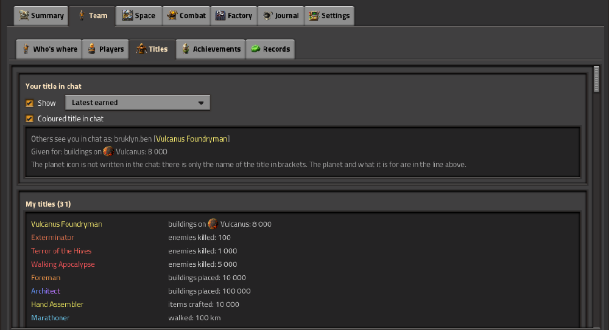

*The Titles tab: the titles you earned and the one that shows in chat.*

A new title is announced in chat to everybody, a personal achievement only to the player who got it, a team achievement to the whole team. Every player can switch these messages off for themselves.

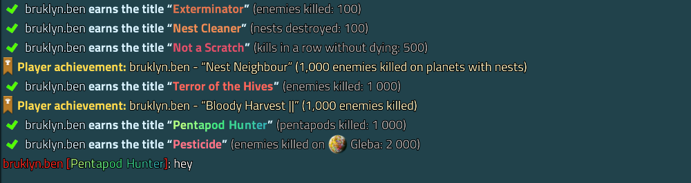

*New titles and achievements in chat, and the chosen title in brackets next to the player's name (last line).*

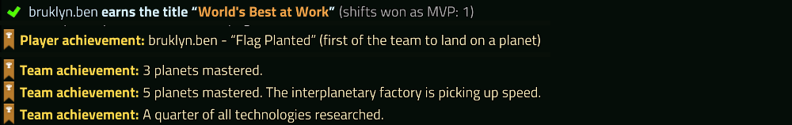

*In chat (as the player who got them sees it): a new title, a personal achievement and the achievements of the whole team.*

## Shifts and MVP

- At the end of every shift a summary appears in chat: leaders, destruction, research, planets, power problems.
- Players vote for the MVP, the vote is secret. If nobody votes, the mod picks the MVP itself by the share in kills, buildings, mining and distance, and the journal says why.

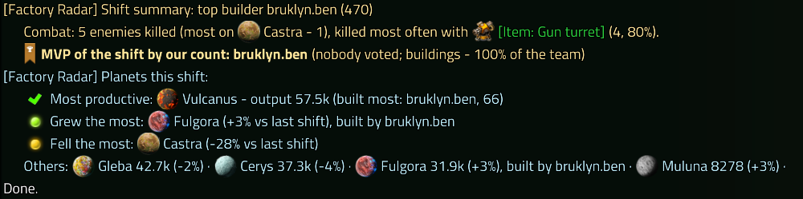

*The shift summary in chat: the top builder, combat, the MVP and the planets of the shift.*

## Fun stuff

- **Lightning**: strike a friend with a lightning bolt. It never kills, it only takes part of the health. Several players can strike the same target.
- **Quiz**: anybody can start it, those who agree take part, fate picks one of them and a surprise awaits that player. One quiz at a time, with a cooldown.

---

# Works with your setup

- **Other mods**: works with the base game, with Space Age and without, with Quality and without. Modded planets, space locations and enemies are picked up by themselves, with their own icons.
- **Seen working** in a pack of about 200 mods: Space Age, Quality, Krastorio 2: Spaced Out, and the planets of Castra Prime, Planetaris (Arig, Hyarion, Tellus), Corrundum, Muluna and Cerys.
- **Languages**: English and Russian, follows the game language. Support in both.
- **Multiplayer**: safe, nothing in the world is changed except what you ask for (the lightning and the quiz).
- **Light on UPS**: only the open tab is built, the heavy counting is done in small steps.
- **Settings**: an admin can switch every feature on or off and reset or undo any statistic, one section at a time. Players hide the tabs and chat messages they do not need, each for themselves.

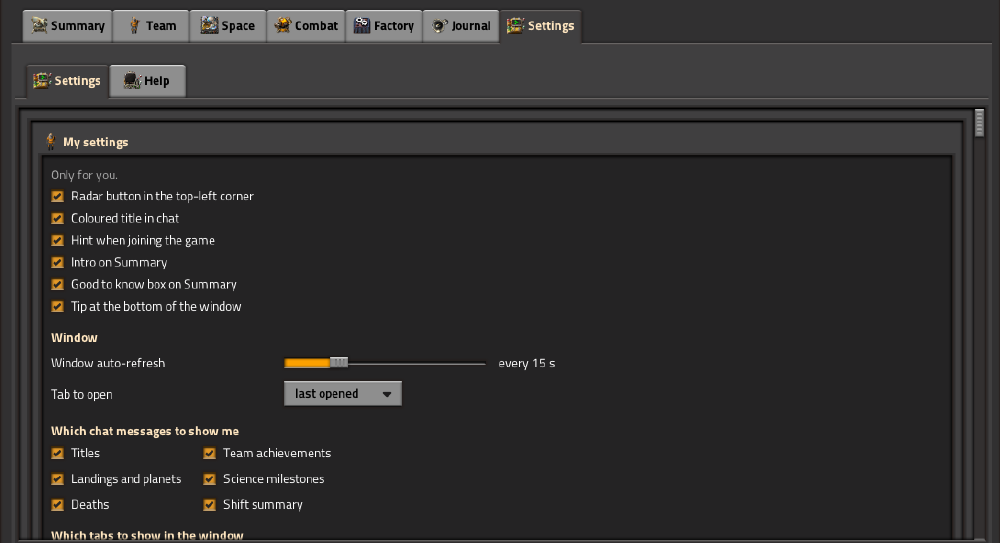

*Settings: every player hides the tabs and the messages they do not need.*

## Commands

Everything is also in the window, the commands are for quick use from chat.

| Command | Who | What it does |
| --- | --- | --- |
| `/tr-now` | everyone | Right now: who is online, the shift leaders, the planets and the time left to the shift summary |
| `/tr-top [shift]` | everyone | Team leaderboard: all time, or for the current shift with the word shift |
| `/tr-me [name]` | everyone | Your player card: stats and the next titles; with a name, the card of that player |
| `/tr-vs name` | everyone | Compare yourself with another player, number by number |
| `/tr-where [name]` | everyone | Who is where and where they look; with a name, only that player |
| `/tr-planets`, `/tr-research`, `/tr-combat`, `/tr-log` | everyone | Short reports in chat: planets, research, combat, the journal |
| `/tr-mvp name` | everyone | Vote for the MVP of the shift (the vote is secret) |
| `/tr-zap name` | everyone | Strike a player with lightning (never kills, has a cooldown) |
| `/tr-roulette`, `/tr-in` | everyone | Start the quiz, agree to take part |
| `/tr-shift-now` | admin | Sum up the shift right now |
| `/tr-census` | admin | Recount who built what on the planets |
| `/tr-zap-lift number` | admin | Fix the height of the lightning |

## Versions

`1.0.x` is for Factorio 2.0 (2.0.36 or newer), `1.1.x` is for Factorio 2.1 (2.1.7 or newer).

## Bugs and ideas

Write in the Discussion tab, in English or in Russian. If something breaks, please attach `factorio-current.log` (look for lines with "Factory Radar").
